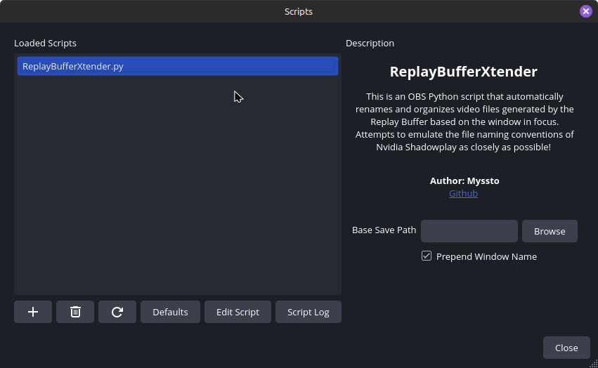

# OBSReplayBufferXtender

This is an OBS Python script that automatically renames and organizes video files generated by the Replay Buffer based on the window in focus. Attempts to emulate the file naming conventions of Nvidia Shadowplay as closely as possible! I recommend combining this with [OBSNotifier](https://github.com/DmitriySalnikov/OBSNotifier) to create an experience that closely resembles Nvidia Shadowplay.

## Installation

### Requirements

- [python 3](https://www.python.org/downloads/)

Windows:

- [pywin32](https://pypi.org/project/pywin32/)
- [psutil](https://pypi.org/project/psutil/)

### Installation

Download the [latest release](https://github.com/myssto/OBSReplayBufferXtender/releases/latest) of ReplayBufferXtender, open OBS, navigate to _Tools > Scripts_, click the + button, and select `ReplayBufferXtender.py`.

## Options

### Base Save Path

`Default: none`

By default, OBS will save Replay Buffer videos to the same path specified at _Settings > Output > Recording > Recording Path_. Supplying a path to this option will override this for Replay Buffer videos only, creating a custom path for clips while keeping regular recordings separate.

### Prepend Window Name

`Default: true`

By default, OBS names videos generated by the Replay Buffer with the format `Replay {date} {timestamp}.{ext}`. Toggling this setting on will replace the "Replay" text with the name of the subdirectory it will be placed into. This is a default behavior of Nvidia Shadowplay

## Behavior

### Platform Support

This script supports Linux (or rather most common window managers utilizing `xprop`) out of the box with both native and Flatpak OBS installs. Windows is supported with the pywin32 and psutil python modules. MacOS is not supported at this time.

### Hotkey Based

This script is intended to be used with a hotkey set to Save Replay Buffer. It is worth noting that the script will use the name of the window in focus _when the video file is created_, not when the hotkey is pressed. If your Replay Buffer file size is large, you may notice inconsistencies when using the hotkey, and then immediately shifting window focus (i.e. Alt + Tab) as the script does not handle video files until they are saved to the disk.

## Questions

If you need any support installing or troubleshooting this script, or have a feature request, please feel free to open an issue here, or message me on Discord @`myssto`. All I ask is that you firstly use common sense problem solving, and check the OBS Script Log to determine any obvious issues first. If you do reach out, please provide any relevant information like OBS version, Python version, your script settings, any errors in the script log, etc. Simply asking _"Help, {x} won't work!"_ will be ignored.
